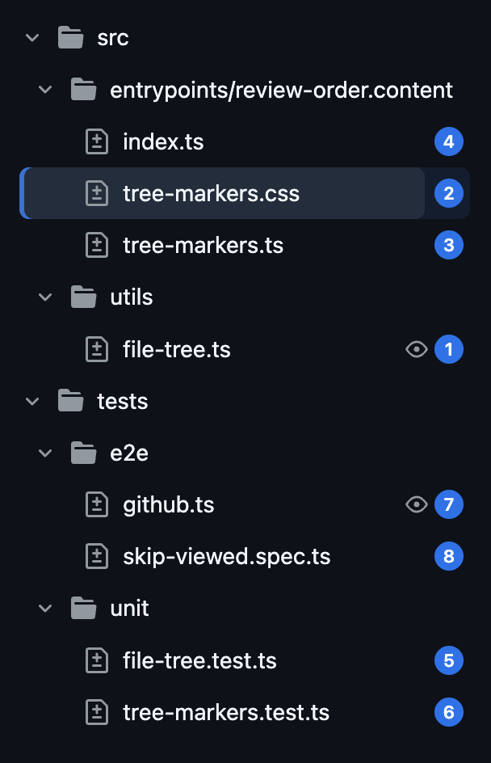

# Github Review Order

This is a browser extension (built with wxt and svelte 5) that allows you to specify in which order to review files in, together with a stepper that takes you through the files in that order.
It also shows you what you have already viewed.
I can't believe I had to build this and it's not a native feature on github.

## Features and how to use

The easiest way to see what this does is to install the extension and look at a the pull requests in this repo. A quick overview:

When creating a PR, add a section in the description (by hand or via agent) according to `skills/pr-review-order/SKILL.md`.
It's simple, just a specific header name followed by a numbered list saying what each file change contains.
Contributors can also comment with a new order later, the latest one is used (unless it's hidden inside github's "load more" comments for now).

### Widget 
When you open the diff view, you get an overlay widget injected into the page. You can drag it around if it bothers you where it is, or double click to minimize/maximize.

What it does:
- top left shows you which file number you are on in the order
- the arrows are pretty self explanatory. They navigate you to the next/previous one
- `reset current` just takes you to the top of the current file in the order in case you scrolled away (or sometimes the original position is janky due to github's loading mechanism)
- the description of the file is taken from the PR description/comments. You can see where it is taken from when hovering the question mark
- files that are not part of the review order are stepped through at the end

**Options**
- `Skip viewed`: The arrow keys ignore files that have the `viewed` marker from github checked and take you to the next unviewed one
- `Auto-advance`: Takes you to the next file in order if you mark a file as `viewed` automatically

### File tree

You also get some updates to github's file tree.
It automatically injects:
- the number in the review order 
- a little eye icon to indicate what you have already seen
- a warning exclamation mark if a file is not listed in the review order

### Examples

- https://github.com/RunOrVeith/github-review-order/pull/12/changes
- https://github.com/RunOrVeith/github-review-order/pull/7
- Any other PR in this repo

## Installing

For now, this is not on the official browser stores and you have to add it to your browser in dev mode.

Run `npm install`, then `npm run build`. It will put the chrome artifact into `.output`.
Ask you favorite agent how to load it in dev mode. 
For other browsers:
...

## Permissions

- Local storage 
- read/change site data

## License

[MIT](LICENSE)
