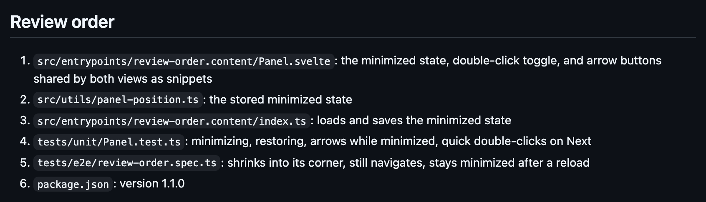
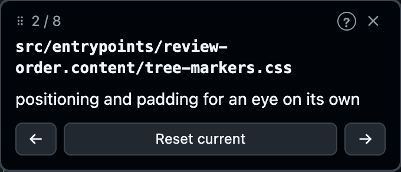

# GitHub Review Order

This is a browser extension (built with wxt and svelte 5) that allows you to specify in which order to review files, together with a stepper that takes you through the files in that order.
It also shows you what you have already viewed.
I can't believe I had to build this and it's not a native feature on github.

## Features and how to use

The easiest way to see what this does is to install the extension and look at the pull requests in this repo. A quick overview:

When creating a PR, add a section in the description (by hand or via agent) according to `skills/pr-review-order/SKILL.md`.
It's simple, just a specific header name followed by a numbered list saying what each file change contains:

```markdown
## Review order

1. `src/utils/review-order.ts`: parses the section, start here
2. `src/entrypoints/review-order.content/Panel.svelte`: the widget that uses it
3. `README.md`: docs
```

If a file doesn't show up, check the rules in the skill. The most common one: it has to be `path: description`, `path - description` doesn't parse.

If you want your agent to write it for you, copy `skills/pr-review-order` into `~/.claude/skills/` (or `.claude/skills/` in your repo). For other agents, just point them at the `SKILL.md`.

Contributors can also comment with a new order later, the latest one is used (unless it's hidden inside github's "load more" comments for now).



### Widget 
When you open the diff view, you get an overlay widget injected into the page. You can drag it around if it bothers you where it is, or double click to minimize/maximize.
If you closed or minimized it, click the extension's button in the browser toolbar and then `Show panel` to bring it back.



What it does:
- top left shows you which file number you are on in the order
- the arrows are pretty self explanatory. They navigate you to the next/previous one
- `reset current` just takes you to the top of the current file in the order in case you scrolled away (or sometimes the original position is janky due to github's loading mechanism)
- the description of the file is taken from the PR description/comments. You can see where it is taken from when hovering the question mark
- files that are not part of the review order are stepped through at the end

How it steps through the files can be changed in the settings, see [Toolbar button](#toolbar-button).

### File tree

You also get some updates to github's file tree.
It automatically injects:
- the number in the review order 
- a little eye icon to indicate what you have already seen
- a warning exclamation mark if a file is not listed in the review order


### Moved code

Code that was only moved, possibly re-indented, gets its own colours in the diff, on every PR and with or without a review order (unless you turn `Show moved lines` off in the settings):
- striped red where it was removed
- striped green where it was added
- hovering it says where the other end is, with a link that jumps there; lines that were only re-indented in place say so

Whitespace is ignored when comparing, and a block has to be at least three lines long (or a line re-indented in place), so common lines like imports and closing brackets don't light up everywhere. The three lines can be changed with `Minimum lines` in the settings.
To read the whole diff, the extension fetches the PR's `.diff` in the background, which is why it asks for access to `github.com` and `patch-diff.githubusercontent.com`.

### Toolbar button

Clicking the extension's button in the browser toolbar opens its settings, which apply to every PR and take effect right away:
- `Skip viewed`: the arrows ignore files that have github's `viewed` marker checked and take you to the next unviewed one
- `Auto-advance`: marking the current file as `viewed` takes you to the next one
- `Show moved lines`: stripes code that was only moved, see [Moved code](#moved-code)
  - `Minimum lines`: how many lines moved code needs before it's striped, 3 by default. Lower catches smaller moves, but also common lines like imports

The three toggles are on by default.

If the widget doesn't show up, the same popup shows what was found on the current tab: which version of GitHub's PR page was read, the review order and where it's from, the file tree, and anything that keeps the widget from working. `Copy report` copies all of it, for an issue. The button gets a `!` badge when there's a problem. If you closed or minimized the widget, `Show panel` / `Expand panel` there brings it back.

### Examples

- https://github.com/RunOrVeith/github-review-order/pull/12/changes
- https://github.com/RunOrVeith/github-review-order/pull/7
- Any other PR in this repo

### Known limitations

- comments hidden behind github's "load more" aren't read, so a newer order in there is ignored
- github is rolling out a new PR overview page. It works too, but it loads comments separately, so there only the description's order is read
- it works off github's page, so if they change their UI it will probably break until I fix it
- no Safari, I haven't tried it
- moved code is only coloured when looking at all of a PR's commits, not a selection of them, and a new push is picked up by GitHub's Refresh only while the panel is open
- code that was moved and edited at the same time only shows the parts that stayed the same


## Installing

For now, this is not on the official browser stores and you have to add it to your browser in dev mode.

Run `npm install`, then build for your browser:

**Chrome, Edge, Brave and other Chromium browsers**
1. `npm run build` puts the extension into `.output/chrome-mv3`
2. Open `chrome://extensions` (`edge://extensions`, `brave://extensions`, ...) and turn on developer mode
3. Click `Load unpacked` and pick the `.output/chrome-mv3` folder

**Firefox**
1. `npm run build:firefox` puts the extension into `.output/firefox-mv2`
2. Open `about:debugging#/runtime/this-firefox`
3. Click `Load Temporary Add-on...` and pick `.output/firefox-mv2/manifest.json`

Firefox removes temporary add-ons when it closes, so you have to load it again after a restart.

To update, pull, build again and hit the reload button on the extension.

## Permissions

- Local storage: remembers your options, where you put the widget, and how far you got in each PR. Progress is dropped after a week.
- read/change site data: only on github.com, to read the review order and inject the widget and file tree markers.

Nothing is sent anywhere. The only requests it makes go to github.com, to load the PR description and comments.

## Development

You're welcome to contribute if there is a clear flow improvement. I'm going to state right now that I will be the judge of what is an improvement.

- `npm run dev` opens a chrome with the extension loaded and reloads it when you change something. It keeps its profile in `.wxt/chrome-data`, so you only have to log into github once
- `npm run dev:firefox` does the same for firefox
- `npm test` runs the unit tests, `npm run e2e` the playwright ones (run `npx playwright install chromium` once before)
- `npm run compile` type checks everything

## License

[MIT](LICENSE)
